# Restaurant POS

A complete point of sale for restaurants, cafes and bars that runs entirely in the browser. It is one file with no install, no server, no subscription and no hardware lock-in. Open `index.html` and you are trading.

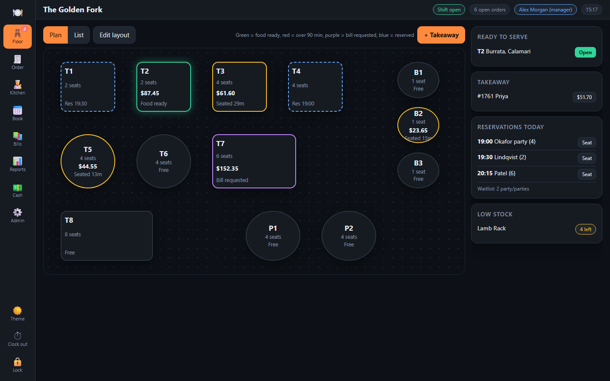

## Quick start

1. Open `index.html` in Chrome, Edge or Firefox (double click the file).
2. Sign in with a demo PIN:

| Role | PIN | Can access |
|---|---|---|
| Manager | `1234` | Everything |
| Server | `1111` | Floor, orders, kitchen view, bookings, bills |
| Kitchen | `2222` | Kitchen display only |

The first launch loads a demo restaurant (30 days of sales history, live tables, bookings, an open cash shift) so every screen has something to show. Use **Admin > Settings > Reset to demo data** to restore it, or empty the menu and tables to start your own venue.

To use a second screen as a kitchen display, open `index.html` in another tab or window of the same browser and sign in as Chef. Tickets appear on it the moment a server taps Send.

## What makes it different

- **Live floor plan** with drag and drop layout editing, not a plain list of table numbers. Tables change colour for food ready, bill requested, reserved, and seated over 90 minutes.
- **Course firing.** Put items in courses 1 to 3, send course 1 to the kitchen and hold the rest. Tap Fire when the table is ready for mains.
- **Seat numbers** on every item, so food runs to the right person and bills can be split per guest.
- **Station routing.** Categories map to stations (Kitchen, Grill, Bar, Dessert). Each station sees only its own items, with an all-day count of what is pending.
- **Three ways to split a bill:** whole bill, equal shares, or tick the exact items each guest ordered. Tax and discounts are shared out proportionally.
- **Manager approval** by PIN for voids, large discounts and refunds, with every approval recorded in an audit log.
- **Happy hour pricing** that switches on and off by itself at the times you set.
- **Gross margin reporting** from item costs, plus server performance, hourly and daily sales, and period over period comparisons.
- **Cash drawer management** with float, paid in and paid out, expected cash, counted cash, variance, and printable X and Z reports.
- **Reservations and a walk-in waitlist** that seat straight into an order.
- **Allergen badges, stock counts and 86 handling** shown at the moment of ordering.
- **Time clock** with hours and labour cost per staff member.
- **Light and dark themes**, keyboard shortcuts, and a layout that adapts to tablets.
- **Your data stays yours.** Everything lives in the browser's local storage, with one click JSON backup and restore.

## Tour

### Taking an order

Category tabs, search (press `/`), colour coded items, allergen badges, and automatic happy hour prices. The ticket groups items by course, shows seat numbers, and lets servers hold, fire, serve and void lines.

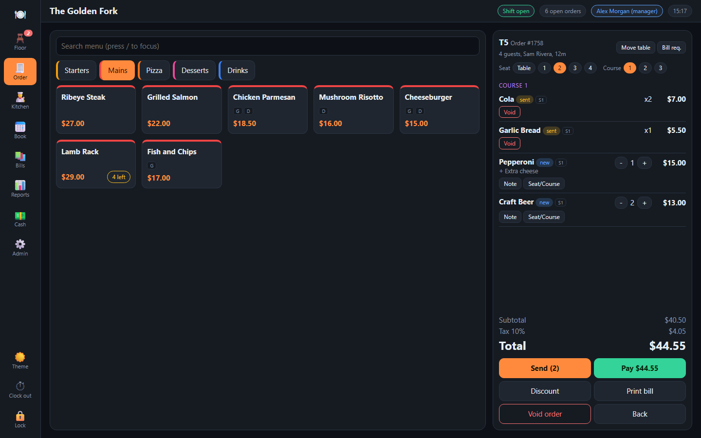

Items with options open a modifier panel with a free text note for the kitchen.

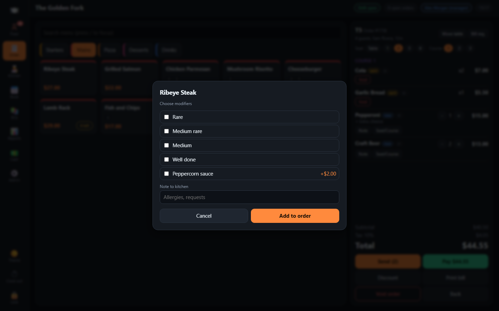

### Paying

Split by items, split equally, or take the whole bill. Add a tip from preset percentages, take cash with quick tender buttons and automatic change, or card and voucher. Partial payments leave the order open until the balance reaches zero.

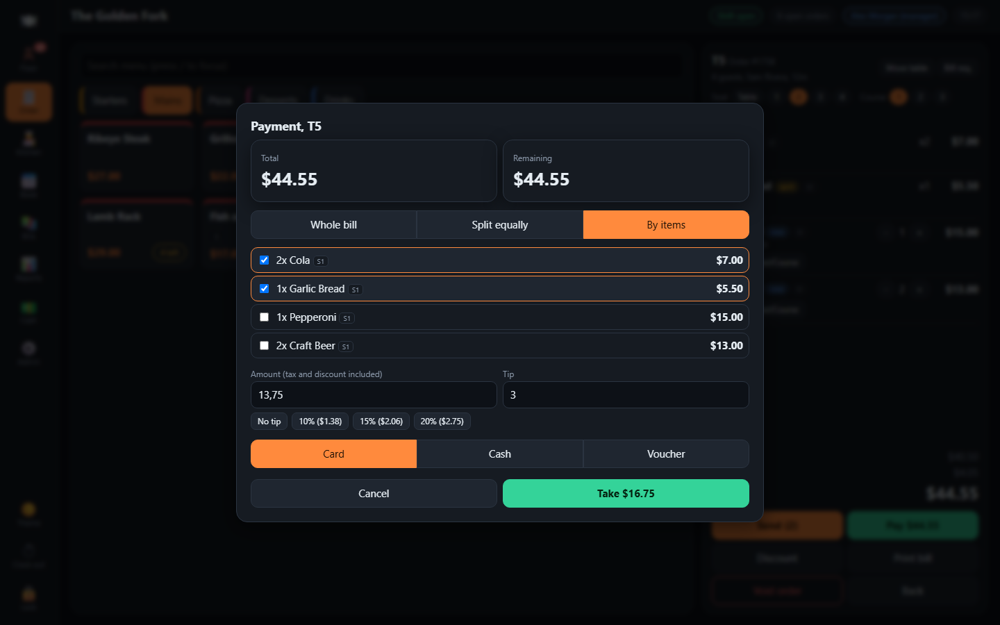

Receipts are formatted for 80mm thermal printers (use the Print button).

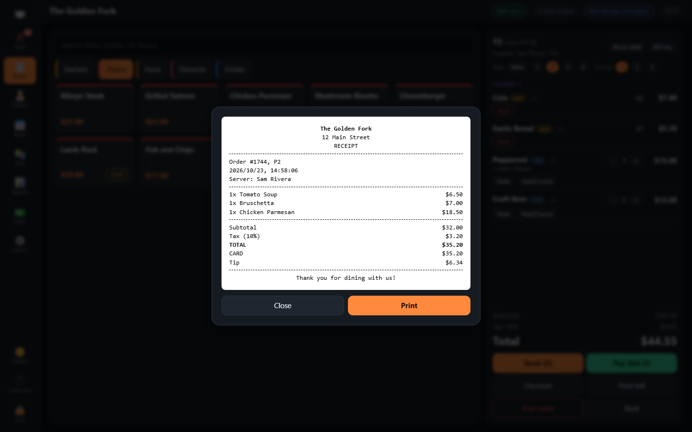

### Kitchen display

Tickets are ordered oldest first and turn amber then red as they age (thresholds are configurable). Filter by station, bump a ticket, or recall one that was bumped by mistake. A sound plays when new tickets arrive.

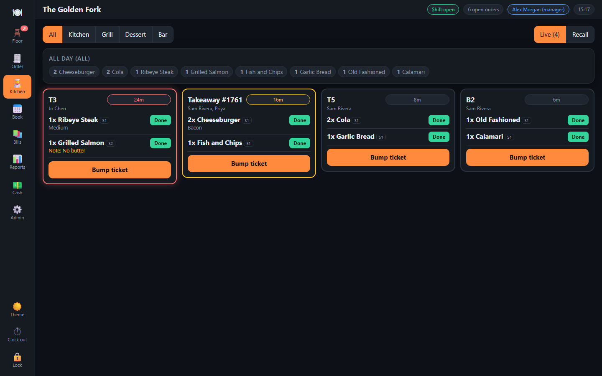

### Reservations and waitlist

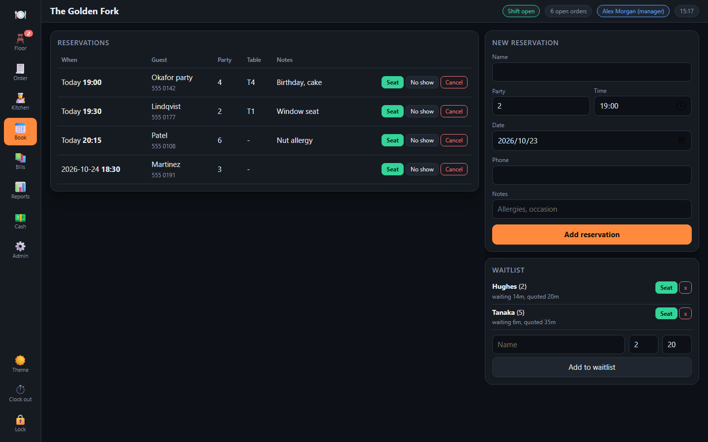

### Reports

Revenue, orders, average check, covers, gross margin, tips and discounts, each compared with the previous period. Sales by hour and by day, category mix, top items, server performance and payment mix. Export closed sales to CSV.

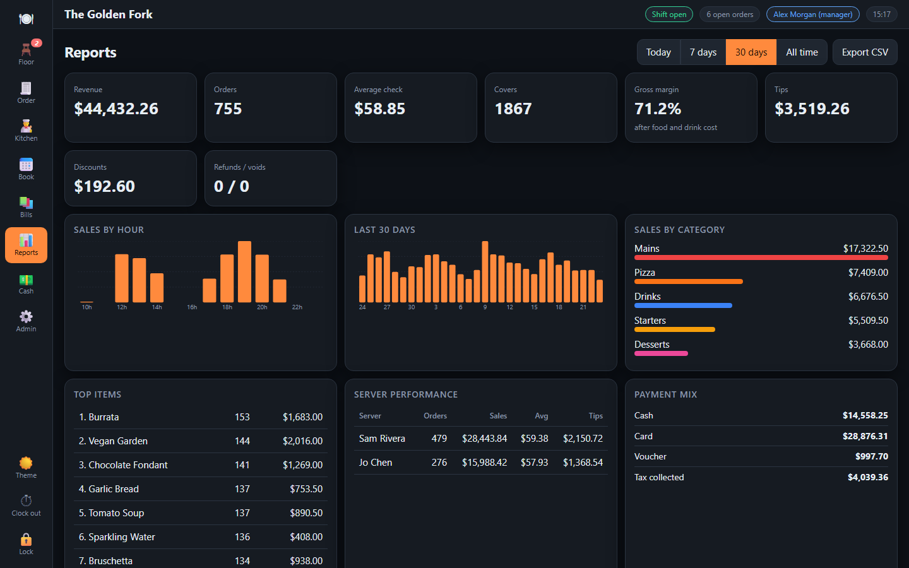

### Cash drawer and Z report

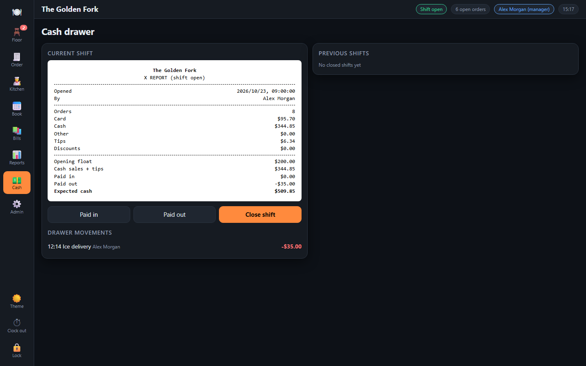

### Admin

Menu items with price, cost, stock, allergens and modifiers, with a live margin column.

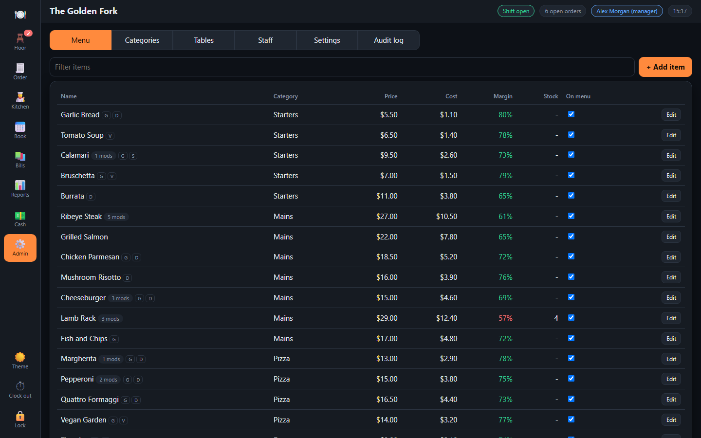

Tax, service charge, tip presets, happy hour, kitchen timers, backup and restore.

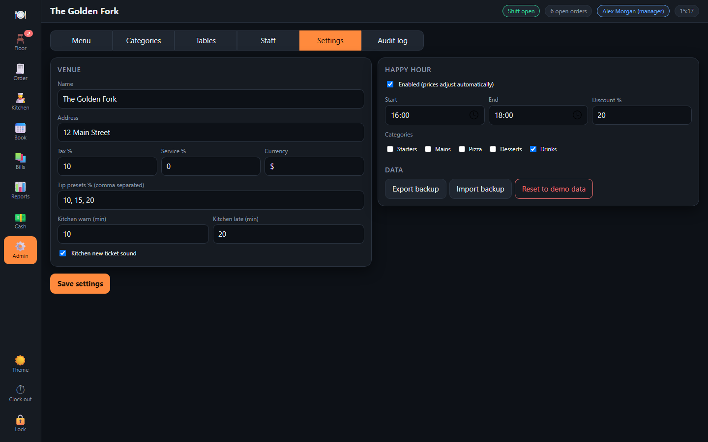

Edit the floor plan by dragging tables, and switch themes at any time.

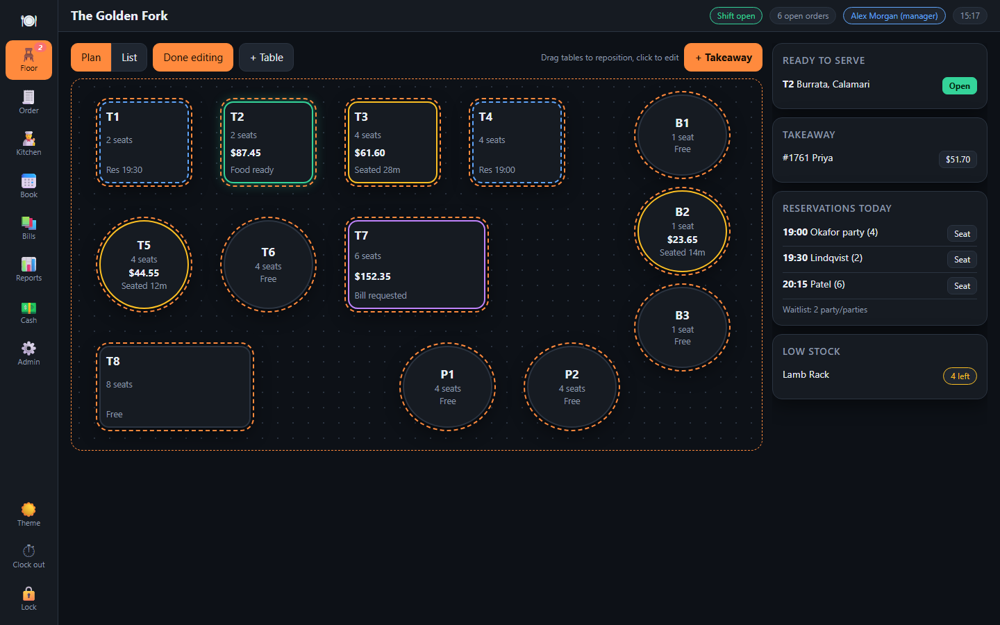
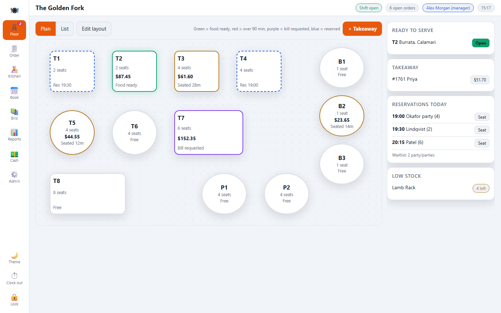

### Sign in

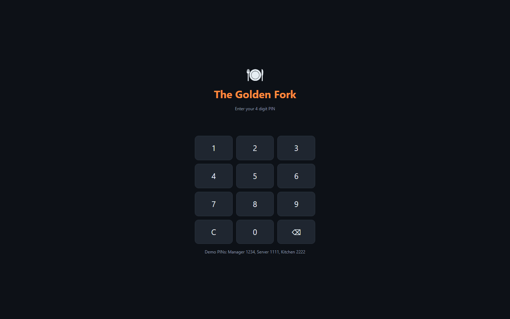

## Keyboard shortcuts

| Key | Action |
|---|---|
| `0-9`, `Backspace` | Enter PIN on the lock screen |
| `/` | Focus menu search on the order screen |
| `Esc` | Close the open dialog |

## Roles and safety

- Servers can apply discounts up to 20% on their own. Larger or fixed amount discounts need a manager PIN.
- Voiding an item or an order needs a manager PIN for servers and records the reason.
- Refunds are manager only and remove the order from sales reports.
- Kitchen staff only see the kitchen display.
- Every sensitive action is written to **Admin > Audit log**.

## Data and backups

Data is stored in your browser's local storage under the key `restaurant_pos_v2`.

- Back up often with **Admin > Settings > Export backup**.
- Clearing site data for the page deletes the database, so export first.
- Orders, kitchen tickets and floor status sync live between tabs and windows of the same browser on the same computer.
- To run several devices against shared data you would need a backend (see below).

## Project layout

```
Restaurant-POS/
  index.html        the whole application (HTML, CSS and JavaScript)
  README.md         this file
  screenshots/      images used above
```

## Demo links for screenshots

When demo data is loaded you can jump straight to a screen, for example `index.html?shot=reports&range=month` or `index.html?shot=order&modal=pay`. Supported parameters: `shot` (login, floor, order, kitchen, book, bills, reports, cash, admin), `role`, `theme`, `range`, `station`, `tab`, `mode`, `edit`, `modal` (mods, pay, receipt). They only work while the demo flag is set and are ignored once you import a backup from your own venue.

## Limitations and next steps

This is a front end only system, so it is ideal for a single counter or a single device pair. For a multi-terminal production deployment you would add:

- A server and database so every terminal shares one source of truth.
- A payment terminal integration (Stripe Terminal, Square, Adyen). Card payments here are recorded, not processed.
- Network receipt and kitchen printer support (ESC/POS).
- Online ordering and delivery platform integrations.
- Ingredient level inventory with recipes and purchase orders.
- Tax and fiscal compliance for your country.

## License

Released under the [MIT License](LICENSE).
